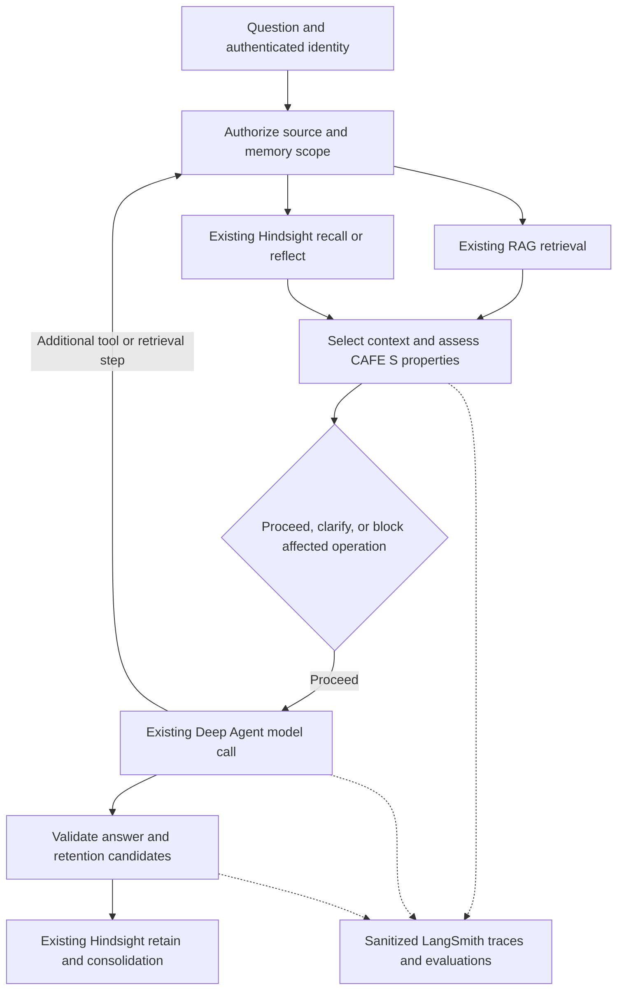

# Backend integration guide

The design can be used as a complete studio or as individual visual components. Keep service-specific routes, authentication, and response mapping in an adapter, and pass normalized view models to the UI.

## Boundaries


| File | Responsibility |
| --- | --- |
| `frontend/src/lib/contracts.ts` | Typed requests/results consumed by the studio: bootstrap, runs, answers, workspace, and the `StudioApi` interface. |
| `frontend/src/services/http-studio-api.ts` | HTTP routes, JSON serialization, timeouts, errors, and write ordering. Replace route/response mapping here when an API differs. |
| `frontend/src/lib/api.ts` | Active adapter and the studio's bootstrap cache. `initializeApi(customAdapter)` selects a backend. |
| `frontend/src/main.tsx` | Startup/composition point. Data loads before the studio is imported. |
| `frontend/src/ui.ts` | Public entry for API-independent `IntelligenceOverview`, `MemoryGraph`, `McpForm`, and `Button` components. |
| `frontend/src/lib/graph.ts` | Local fallback graph layout/relationship inference. Server-provided graph data bypasses this fallback. |
| `backend/app/main.py` | Current local HTTP contract and provider composition. |
| `backend/app/service.py` | Current deterministic question routing, recall, and memory extraction. |
| `backend/app/store.py` | Current single-workspace SQLite persistence. |

## Connect a backend that follows the current contract

Set the public API base URL, including `/api`, in `frontend/.env.local`:

```dotenv
VITE_API_BASE_URL=http://127.0.0.1:8000/api
```

Leave it blank to use Vite's existing `/api` proxy. Restart Vite after changing environment values. For another local target, change the proxy target in `frontend/vite.config.ts`.

The current backend's request schemas are available at `/docs` and `/openapi.json`. A replacement backend must either return the same view models or translate its own responses in a `StudioApi` implementation.

## Connect an HTTP backend with authentication or different routes

`createHttpStudioApi(baseUrl, fetcher?)` accepts an authenticated fetch implementation. For example, a same-origin cookie-authenticated API can be selected in `main.tsx`:

```ts
import {initializeApi} from './lib/api';
import {createHttpStudioApi} from './services/http-studio-api';

const client=createHttpStudioApi('/api', (url, init) =>
  fetch(url, {...init, credentials:'same-origin'})
);
await initializeApi(client);
// Import/render App after this resolves, as main.tsx already does.
```

If an API uses an SDK, different paths, or different response structures, implement the interface in `contracts.ts` and pass that object to `initializeApi`. The component calls remain unchanged. An adapter may delegate compatible methods to `createHttpStudioApi` and override only the methods that differ.

`VITE_*` values are public browser configuration. Connector secrets, service credentials, webhook signing keys, and privileged agent access belong on the backend. The local FastAPI app currently has no authentication. Its CORS configuration must be adjusted if a future API uses another browser origin or cross-origin cookies.

## Wire each area of the UI

| UI area / action | Current binding | Backend integration work |
| --- | --- | --- |
| Source catalog and initial workspace | `bootstrap()` -> `GET /bootstrap` | Return permission-filtered sources, profile, persisted selections, and display metadata. |
| Connect/disconnect a source | `App.tsx` `connect`, context save effect -> `saveContext()` | Configure connector authorization/ingestion. Return confirmed source IDs and metadata; add pending/error state handling if jobs are asynchronous. |
| Add MCP server | `McpForm.onAdd` -> context state -> `saveContext()` | Discover tools/resources/prompts server-side and enforce allowed tool access. The form currently saves endpoint metadata only. |
| Register files | `App.tsx` `addFiles` -> `saveContext()` | Add a byte-upload or signed-upload service plus progress/status callbacks. The current endpoint stores file names only. |
| Try a question and evaluate it | `ContextQuestion` -> `query(question)` -> `POST /query` | Return `{answer, evaluation?}` for that exact question. The local evaluation reports keyword matches in configured sample sources, year presence in record text, and unverified answer grounding. Replace these with real per-question evidence/evaluators; preserve unknowns and evaluation provenance. |
| Knowledge graph and source details | `Bootstrap.knowledgeRecords`, source references, `MemoryGraph` | Fetch actual table/document/vector-index relationships. Pass normalized `MemoryGraphData` to the graph's `graphData` prop; wire the fetch in `App.tsx`. |
| Agent question | `startRun(question, context)` -> `POST /runs` | Start the orchestrator and return a stable run ID with normalized initial status. |
| Context quality | `reviewContext(context)` -> `POST /context/review` | Return findings from the real task, RAG results, Hindsight context, and assembly policy. Recheck the context actually used during execution; a preview alone is insufficient. |
| Agent progress and memory saving | `pollRun(id)` -> `GET /runs/{id}` | Map agent/tool/memory events to the `AgentRun` view model. Keep memory persistence on the server. |
| Memory details, correction, approval, invalidation | `CompoundingConsole` -> `saveMemories()` | The local API accepts a full snapshot. A production adapter can issue per-record/versioned commands and then return refreshed canonical workspace state. |
| Compounding Intelligence overview | `IntelligenceOverview` -> record-derived summary and navigation callbacks | Supply current memory records, timestamps, source references, approval/validity, and evidence IDs. Counts represent eligible records, not accuracy gains. `onAsk` prefills a related stored question in Super Agent without sending it. |
| Memory relationship graph | `MemoryGraph` records and `onInspect` | Pass authoritative graph nodes/edges through `graphData`; keep pan, zoom, node dragging, and selection in the component. |
| Consolidation | `CompoundingConsole.consolidate` -> local derivation -> saves | Replace derivation with a server consolidation command and reload affected records/models/pages. |

The fixed-suite `/evaluations` endpoint and advanced `IntelligenceTools` components remain available for integration work but are not exposed by the main shell. The Context Layer uses the question-specific evaluation returned by `/query`; its results must not be replaced by aggregate suite scores. Query calls wait for pending configuration saves, and the panel discards results after question/source changes. Neither querying nor its local evaluation writes memories. This table distinguishes an existing API call from a future service connection. The current local backend does not execute MCP tools, ingest file contents, query Azure AI Search, invoke LangChain/LangSmith, or deliver webhooks.

## View-model rules to preserve

- IDs must remain stable between polling, graph selection, and persistence.
- `saveContext`, `saveMemories`, `saveBank`, and `reset` return a complete canonical `StudioState`. A backend that returns `204` must be adapted by fetching refreshed state.
- The HTTP adapter serializes writes and waits for pending context edits before starting a run. SDK adapters should provide equivalent ordering or use server-side version/concurrency controls.
- Failed requests reject with an `Error` whose message is safe to show. Do not hide persistence failures behind a successful response.
- `AgentRun.tick` is the current UI's progress scale from 0 to 12. Normalize an orchestrator's progress into that range. `complete` means its answer and reviewable memories have been persisted. Return `memories` on completion.
- `AgentRun.answer` supplies title, summary, metrics, findings, recommendation, and source references. Citations use that run's response, so new backend topic labels do not depend on canned bootstrap answers.
- In the local demo, `confirmed` is human review approval and `state` is fact validity. Its recall helper requires approval for every reused record. This is a demo policy, not a native Hindsight requirement or a CAFE(S) rule. Preserve the private backend's actual eligibility policy. If it permits automatic reuse, adapt the view model/UI to distinguish eligibility from human review; do not label automatically eligible memories as human-approved. Enforce invalidation and any policy-required approval on the server.
- Existing display labels map to memory taxonomy as follows: `Observation` -> world fact; `Learned pattern` -> derived observation; `Session context` -> experience. Normalize a provider's taxonomy at the boundary.
- `sourceFactIds` link observations to their evidence. Corrections/invalidation must revoke or rebuild affected derived knowledge and cached models.
- API-generated graph nodes need stable IDs, finite `x/y` positions, a `memory` detail model, and a `sourceFacts` count. Every edge must reference existing nodes and use one of the supported relation types. Supply complete detail models so the inspector can open immediately.

## Reuse the graph without this application or FastAPI

The graph component imports no bootstrap state and makes no HTTP calls. A host can fetch from any backend and pass its data:

```tsx
import {MemoryGraph,type MemoryGraphData,type Memory} from './src/ui';

export function MemoryMap({graph,onOpen}:{
  graph:MemoryGraphData;
  onOpen:(memory:Memory)=>void;
}) {
  return <MemoryGraph
    memories={graph.nodes.map(node=>node.memory)}
    graphData={graph}
    mode="memory"
    onInspect={onOpen}
  />;
}
```

Use `mode="knowledge"` for the source-oriented labels. Omitting `graphData` uses deterministic local inference, which is suitable for this local dataset and is not an authoritative enterprise graph.

The component maintains temporary viewport and node-position state. `onInspect` hands the selected record to the host's editor, route, or details view. It does not write a memory or persist a graph layout.

For the same appearance, retain the React/Radix/Lucide dependencies, `@/` alias, Tailwind/PostCSS setup, and stylesheet order described in `frontend/README.md`. Business service changes belong in the adapter/action handlers; colors, spacing, typography, and responsive layout remain in the stylesheets.

## Context review UI and private backend handoff

Super Agent Insights opens **Super Agent** with a blank chat composer for new users. Context settings are available from the composer. The four main layers remain independently accessible; **Context quality** is a secondary CAFE(S) assessment page. Source/MCP configuration and memory curation use the existing local API.

### Connected local checks

`POST /api/context/review` accepts a structured request:

```ts
type ContextReviewRequest = {
  brief: {objective: string; region: string; period: string; metric: string; deliverable: string};
  pinnedIds: string[];
  scenario: 'ready' | 'missing_scope' | 'stale_evidence' | 'noisy_context' | 'unsafe_context' | 'draft_memory';
};
```

The frontend refreshes the report when the brief, evidence pins, source selections, or memory review state changes. It discards responses for older inputs. Reports include five check results/methods, a decision, checked time, packet ID, selected/excluded records and reasons, approximate text-token counts, the evaluated brief, and explicit limitations. Types live in `frontend/src/lib/investigation.ts`; rules live in `backend/app/context_quality.py`.

- Clarity and actionability check required task fields and the expected output.
- Fidelity checks that requested records resolve, their demo source is configured, and their version matches the fingerprint of the loaded demo corpus. It does not verify factual truth or enterprise source freshness.
- Efficiency removes duplicate/unrelated demo candidates and checks a text-size estimate. This is not a model tokenizer or a complete model-input budget.
- Memory selection uses current approval, validity, and supporting-record eligibility.
- Security checks a local read-only/source boundary and a narrow illustrative instruction heuristic. It is not enterprise authentication or comprehensive prompt-injection defense.

The user-facing UI always sends `scenario: ready` and exposes no fault-injection controls. The other scenarios remain API-only local test fixtures; they modify candidate copies without rewriting source records or approving memories. The generic UI labels **Scope**, **Timeframe**, and **Focus** map to the existing `region`, `period`, and `metric` fields to preserve API compatibility. These fields and the expected outcome remain required by the current local policy; revise that policy during private-backend discovery for tasks that do not need them.

### Run creation now requires context

`StudioApi.startRun(question, context)` sends `{question, context}` to `POST /api/runs`. The question must match `context.brief.objective`. Omitting context is rejected with `422`; a failed review is rejected with `409` before a run is written. The server recomputes against current workspace state, so an earlier passing preview cannot authorize a run after source selections change. `GET /api/runs/{id}` returns the saved `contextReview` snapshot; older stored runs without that field remain readable.

Existing consumers must send the structured context when creating runs. The quick-question endpoint remains a separate fixture demonstration, not a Super Agent run.

### Production mapping

Use the private-backend discovery phase in the implementation plan to map real RAG results, versions, runtime permissions, memory eligibility, agent hooks, and LangSmith traces into these view models. Remove the synthetic fault-injection scenarios from production-facing requests. Validate provider responses in the adapter, preserve unknowns, and bind reviews to authoritative task/source/policy revisions.

The UI distinguishes available records, pinned review intent, reviewed packet contents, recalled memories, and answer citations. A reviewed demo packet is not evidence of what a live LLM consumed. Source ingestion, model-based answer generation, enterprise authorization, Hindsight calls, and LangSmith tracing remain unimplemented here; agent answers are still prepared fixture responses.

Task drafts and pins remain browser-local. The latest run ID restores one backend run after reload. Old stored action drafts are preserved for compatibility, but the action-planning UI is no longer exposed. Persist tasks through the real backend before claiming shared durable workspaces.

## Add CAFE(S) while keeping Hindsight active

**Keep the existing RAG engine, Deep Agents orchestration, and Hindsight recall, reflection, retention, and consolidation.** Add context checks at their current boundaries. Excluding a memory from one answer does not delete it, invalidate it globally, or disable the memory service.

The [CAFE(S) paper](https://research.google/pubs/cafes-your-agent-is-only-as-good-as-its-context/) defines context quality through Clarity, Actionability, Fidelity, Efficiency, and Security. It does not supply a replacement engine, a universal quality score, or a requirement for human approval of every memory. The mechanisms below are application design proposals informed by the paper.

### First inspect the private backend

The production repository is not available in this checkout. Follow [Phase 0 of the implementation plan](CONTEXT_QUALITY_IMPLEMENTATION_PLAN.md#3-phase-0-learn-and-document-the-implemented-rag-engine) before selecting hooks or changing behavior. Record deployed versions and trace one existing request through retrieval, automatic memory injection, agent/subagent model calls, reflection, compaction, and retention. Reuse the current adapters, middleware, policies, and persistence.

Do not copy the demo's required region/period/metric fields, all-memory approval requirement, keyword retrieval, or synthetic checks into the private backend as production policy. Derive necessary scope from the request and ask for clarification when missing information would materially affect the result.

### Integration boundaries

The following is a logical model-step flow. Preserve existing orchestration and concurrent retrieval where appropriate, and repeat the relevant checks as the agent obtains additional context.



| Boundary | What to add | What stays active |
| --- | --- | --- |
| Before retrieval or memory reasoning | Resolve authorized banks, sources, and applicable user/project scope in trusted backend code. Scope provider processing before protected content reaches models or rerankers. | Existing authorized RAG and Hindsight calls. |
| After retrieval and recall | Preserve IDs, provenance, memory type, relevant dates, and available validity/review metadata. Select appropriate records, remove duplication, and explain exclusions. | Hindsight's existing retrieval/ranking and stored memories. |
| Before each relevant model call | Review assembled instructions, history, evidence, memory, and tool output after injection/compaction. Record selected references and coverage limits. | Deep Agents planning, tools, and supported subagents. |
| Before retention | Preserve source lineage and distinguish user statements, observed results, and agent inferences. Apply existing retention/review policy and idempotent writes. | Automatic learning and consolidation wherever the existing policy permits them. |

Implement these checks through the backend's existing tool wrappers, middleware, or graph stages. [Deep Agents supports custom middleware](https://docs.langchain.com/oss/python/deepagents/customization); verify ordering and subagent coverage in the installed version. An added hook must not accidentally replace existing memory middleware or run before later memory injection without recording that coverage gap.

### Decide eligibility for the current task

| Dimension | Practical behavior |
| --- | --- |
| Clarity | Resolve consequential ambiguity in the request or context. Preserve explicit assumptions instead of inventing requirements. |
| Actionability | Establish the requested result and completion criteria without forcing every conversation into a form. |
| Fidelity | Distinguish source facts, previous decisions, preferences, and inferred patterns. Check applicable dates, provenance, validity, and conflicts where evidence permits. Missing metadata remains unknown. |
| Efficiency | Remove irrelevant repetition and budget the combined request while retaining necessary evidence. |
| Security | Enforce access and scope before use. Retrieved memory text cannot change trusted instructions, bank selection, or tool permissions. |

For example, an old refund policy can remain useful for a historical question while a current authoritative policy is selected for today's answer. Keep the historical memory stored, explain the task-specific exclusion, and retain a correction with lineage when supported. A user preference can remain useful alongside both policies. RAG results do not automatically outrank all memory; authority depends on the claim, source, and applicable time.

Keep reuse eligibility separate from review approval and memory type. If approval is required only for shared decisions, do not hold back every personal preference or routine retained event. Likewise, retain a useful inference as an inference rather than silently promoting an unsupported model response into a verified fact. Map these distinctions to actual provider/application fields; do not assume Hindsight has the demo's `confirmed` flag.

[Hindsight recall](https://hindsight.vectorize.io/developer/api/recall) supplies structured results and scope/budget controls. Use supported filters to narrow eligible content after bank authorization. Confirm untagged-memory behavior explicitly: default tag matching can include untagged records, and filters alone are not an authorization system. Budget the final model request separately from the memory response.

### Keep reflection, with checks inside its scope

**Keep `reflect()` enabled when its evidence scope satisfies the applicable policy.** It retrieves and reasons internally, so filtering only its returned answer is too late to control what its internal model consumed.

Use the deployed service's supported filters, hooks, or governed bank boundaries to apply eligibility before that reasoning. Cover facts, observations, mental models, and any other enabled derived-context path. Inspect directives separately: [current Hindsight reflection documentation](https://hindsight.vectorize.io/developer/api/reflect) states that global directives can still apply under strict data filtering. Request supporting references when available; missing lineage must remain visible rather than being treated as verified support.

If a particular reflection path cannot enforce a mandatory rule, isolate that affected operation until it is fixed. Where policy permits, eligible Hindsight recall results can still support reasoning in the governed main agent. Other authorized Hindsight operations remain active. If required evidence cannot be obtained through a permitted path, clarify, narrow, or stop the task; do not silently use unrestricted memory.

### Observe first, then enforce selectively

1. Record the existing behavior and context composition in sanitized LangSmith traces. Identify the run/model step, selected and excluded references, check methods, and policy versions; avoid duplicate root traces or unnecessary raw private content.
2. Run new quality diagnostics in observation mode while retaining existing authorization, invalidation, and mandatory eligibility controls. Keep legitimate recall, reflection, and retention operating to establish a comparable baseline.
3. Compare answer quality, useful memory recall, latency, token use, false exclusions, and cross-scope behavior on the same permitted tasks and source/memory snapshots. Isolate evaluation writes so variants do not learn from one another's answers.
4. Enable demonstrated checks gradually. An irrelevant item can be omitted, an ambiguity can request input, and a mandatory access failure can block the affected operation. An optional memory failure may permit a clearly identified RAG-only answer when sufficient evidence remains and policy allows it; memory-dependent tasks must not silently lose that dependency.

Return `pass`, `fail`, `unknown`, or `not_applicable` findings with evidence and a corrective action, plus the backend's proceed/clarify/block decision. A numerical average must not erase a mandatory failure. A preview is informational; execution rechecks current scope, policy, and the actual assembled request.

Acceptance requires a permitted request that uses real RAG evidence and Hindsight context, an inspectable model-input manifest, an answer with usable references, and supported retention afterward. Also demonstrate task-specific exclusion without deleting memory, enforced reflection scope, and corrections remaining effective during retries/resume. These are private-backend integration checks; the local fixture tests do not establish them. See [implementation-plan sections 8–10](CONTEXT_QUALITY_IMPLEMENTATION_PLAN.md#8-deep-agents-integration) for the detailed agent, memory, and tracing work.

## Verify a replacement adapter

1. Run `npm --prefix frontend test` and `npm --prefix frontend run build`.
2. Confirm bootstrap loading/error/retry, source configuration, and ordered saves.
3. Start and poll a run; verify citations use its own returned evidence.
4. Correct a memory, save/approve it, reload, and verify the canonical server state.
5. Check source permission filtering and evidence eligibility in the backend, not only the browser.
6. Verify graph IDs/relationships, node inspection, and mobile navigation with real response sizes.
7. For a CAFE(S) rollout, verify real Hindsight recall, scoped reflection, and retention remain operational. Check excluded-memory and cross-scope cases at the processing boundary, not only in the final answer; compare against the baseline for excessive exclusions.

The current adapter tests cover injected transports, route mapping, ordered writes, recovery after failed writes, and JSON/error handling. Backend tests exercise the local contract. Neither test suite claims a live enterprise integration.
