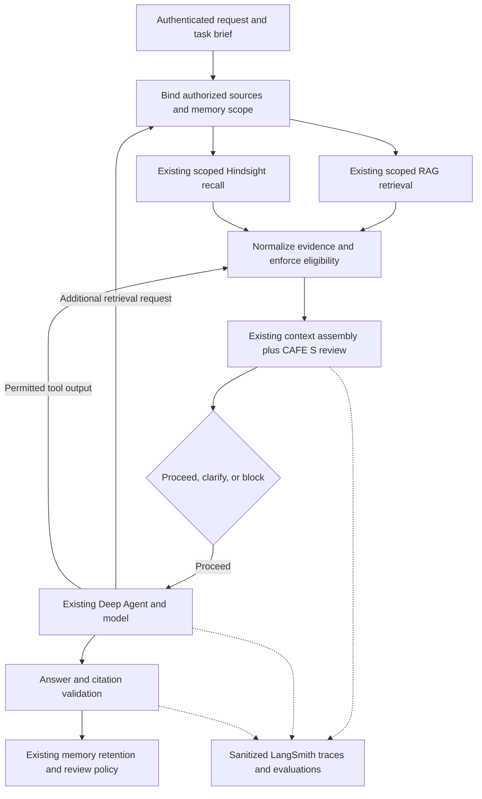

# CAFE(S) context quality: backend implementation plan

Date: November 8, 2026  
Revision: 2; reviewed for implementation gaps and first-release scope  
Status: implementation plan; no runtime changes made

## 1. Feasibility and intended outcome

**Yes, this is feasible as an extension to a backend that already integrates a RAG engine, Deep Agents, LangSmith, and Hindsight.** The preferred approach is to review and govern the context assembled by those systems, preserving their existing responsibilities. Change retrieval internals only where discovery shows that required evidence, provenance, access controls, or lifecycle information cannot be obtained at the current boundary.

The product outcome is an inspectable answer to: **Does this agent have appropriate, relevant, current, and sufficiently clear context for this task, and what needs to change if it does not?**

The live backend is in a private repository that is unavailable for this planning exercise. The user confirms that the integrations exist there; their versions, topology, and behavior remain unverified. This checkout contains a separate FastAPI/SQLite mock. Its fixture answers, keyword recall, timer-driven progress, and memory records are not evidence of how the private RAG engine works. This document is self-contained and can be copied into the private repository.

**Instruction to the implementer: first inspect and understand the private repository. Do not implement this plan against assumed retrieval, agent, tracing, or memory behavior.** Phase 0 is required. Map the plan to existing modules and reuse them before introducing files, tables, adapters, or dependencies.

### What the research supports

CAFE(S) defines five properties of context: Clarity, Actionability, Fidelity, Efficiency, and Security. It evaluates the assembled information environment, including instructions, history, retrieved evidence, tool output, and memory. It does not prescribe a retrieval architecture, supply validated detectors, define a numerical scoring system, or establish that good context guarantees safe autonomy. [1, pp. 2-6, 11-12]

Apply these principles:

- Confirm that information exists, can be accessed, and can be retrieved before assessing the assembled context. [1, pp. 4, 9]
- Fix missing, incorrect, and stale context before optimizing for shorter context. Efficiency means preserving useful signal, not minimizing tokens at any cost. [1, pp. 6, 9]
- Evaluate context for the task and point of use. The same content can be useful in one scope and irrelevant in another. [1, pp. 9-10]
- Give important shared context ownership and proportionate review. Keep personal context private unless sharing is intentional and permitted. [1, pp. 10-11]
- Keep context quality separate from authorization to execute actions. [1, p. 11]

The implementation mechanisms below are engineering proposals informed by the paper, not features provided or validated by it.

## 2. Scope and first release

Deliver one vertical slice through the existing backend:

1. A lightweight, editable task brief, derived from the user's request without silently inventing requirements.
2. An inspectable manifest of the context actually supplied to a model, with source and memory references.
3. Evidence-backed context findings, each with a specific corrective action.
4. Enforcement of existing access, validity, and approval policies before context reaches a model or memory reasoning service.
5. LangSmith traces and a small regression dataset comparing the existing flow with the new behavior.
6. Backend responses that can power Context Layer, Knowledge Layer, Super Agent, and Memory views.

Initially support one representative investigation workflow and the retrieval/memory paths it actually uses. Identify alternate paths that can feed that workflow; govern them or disable them for the rollout. Unrelated workflows do not need to be rebuilt to ship this slice, and must not be advertised as covered.

| First release | Later, only if demonstrated failures justify it |
| --- | --- |
| Existing retrieval and memory integration; application-visible input manifests; essential deterministic checks; safe run responses; regression evidence. | Automated semantic contradiction detection, model-judged ambiguity, automatic memory refresh, new graph views, and broad retrieval tuning. |

Preserve the backend's actual review policy. CAFE(S) does not itself require a human to approve every extracted fact. Establish whether review applies to source documents, extracted facts, shared decisions, or none of these; apply approval-specific requirements below only where that product policy requires them. Do not create a new approval workflow as an accidental prerequisite for observing context.

Do not initially build a new RAG engine, vector database, context microservice, orchestration framework, automatic prompt optimizer, or universal CAFE(S) score. Do not replace Hindsight with a second memory system, duplicate LangSmith dashboards, or require users to complete a long prompt template.

## 3. Phase 0: learn and document the implemented RAG engine

### 3.1 Establish the actual system boundary

- Read repository instructions, architecture documents, dependency locks, runtime configuration names, deployment manifests, tests, and existing evaluation reports. Do not print credentials or private production content.
- Locate the request entry point, background job/worker, Deep Agent construction, graph/checkpointer if present, retrieval tools, Hindsight calls, LangSmith instrumentation, and response/citation mapping.
- Record the deployed package/server versions and whether execution is Python, TypeScript, or another runtime. Use documentation compatible with those versions; the reference links in this plan describe current public capabilities.
- Identify existing equivalents of the proposed task brief, context metadata, authorization checks, review records, and run state. Extend those equivalents instead of creating competing sources of truth.
- Agree on the first workflow, allowed data classes/providers, mandatory checks, existing memory review policy, and acceptable latency/error behavior. Mark new policy choices explicitly; do not infer them from the demo UI.

### 3.2 Follow ingestion through to model input

Document the real flow, with file paths, symbols, services, and evidence for each item:

| Area | Questions the repository investigation must answer |
| --- | --- |
| Ingestion | Which connectors and file parsers run? How are updates, deletes, extraction failures, and schema changes handled? |
| Indexing | What are the chunk boundaries, stable document/chunk IDs, embedding model/version, indexes, metadata, and source versions? |
| Retrieval | Is retrieval vector, keyword, hybrid, SQL, graph-based, or a combination? Where are queries rewritten, decomposed, filtered, reranked, and limited? |
| Access | Where are tenant, user, team, source, and field permissions enforced? Are they applied before protected content reaches rerankers, models, caches, or traces? |
| Evidence | Do results carry source locations, versions, event/validity dates, retrieval scores, and citation IDs? Which fields are unavailable or inferred? |
| Agents | Which components retrieve context: the parent, tools, existing subagents, skills, filesystem reads, or external agent services? |
| Assembly | Where are instructions, conversation history, RAG evidence, tool outputs, and Hindsight results combined? What does the actual outgoing model request contain? |
| Compaction | What truncates, summarizes, offloads, or caches context? In which order? Can required evidence or task constraints disappear? |
| Memory | Is Hindsight used through tools, graph nodes, direct SDK calls, MCP, or a store adapter? Which operations automatically recall, retain, reflect, or consolidate? |
| Memory governance | How are banks selected and authorized? What represents review approval, validity, scope, source lineage, corrections, and deletion? |
| Observability | Which calls already have LangSmith spans? Are inputs, outputs, metadata, model calls, and Hindsight internal activity sanitized? |
| Execution | How do cancellation, retries, timeouts, budgets, checkpoint resume, duplicate requests, and worker failure behave? |
| Streaming | Which data is emitted before validation, and can a failed final check actually withhold an answer or action? |

Capture one permitted end-to-end trace for a normal question and inspect existing examples of an unsupported question and a stale/conflicting-evidence question. Use a test environment and sanitized data. If a capability is undocumented or unobservable, record it as unknown rather than inferring it from a UI label.

Distinguish three things in the discovery notes: what exists in source code, what is configured in the deployed system, and what has been demonstrated by a test or trace.

### 3.3 Choose the integration location from evidence

| Existing implementation | Preferred integration |
| --- | --- |
| Conventional retrieve-then-generate RAG | Normalize retrieval results and review the assembled context at the existing pre-generation boundary. |
| Agent retrieves iteratively through tools | Govern retrieval/tool results and inspect each relevant outgoing model request. A startup-only check is insufficient. |
| Existing Deep Agents/LangGraph middleware or graph stages | Extend the existing stage/hooks. Verify hook order against memory injection, summarization, and provider serialization. |
| RAG is an external service | Adapt its response and require usable provenance/access guarantees. If these are unavailable, extend that service's contract; do not fabricate verification locally. |
| Existing memory gateway | Extend it for Hindsight eligibility, scope, lineage, and retention. Do not add a competing recall path. |

**Deliverable:** a short `docs/RAG_ENGINE_DISCOVERY.md`, or an equivalent section in existing architecture documentation, containing the real call graph, relevant code symbols, versions, data contracts, existing controls, gaps, and chosen insertion points. Include a proposed file-by-file change list, baseline results, and a coverage table identifying observable, provider-internal, and unsupported paths.

**Exit condition:** the implementer can explain the application-visible context sent to each relevant call, identify what remains hidden inside provider services, and distinguish retrieval failure from assembly, policy, or generation failure. Do not begin enforcement on a path whose mandatory policy boundaries are unknown. Missing test access need not block repository analysis or local contract tests, but live verification must remain explicitly pending.

## 4. Architecture: add context review at the existing boundaries

This is a logical flow, not a requirement for new services or sequential retrieval. Preserve the backend's existing concurrency where safe. Scope must be bound before retrieval/provider processing; output checks are additional controls, not the first authorization boundary. Hindsight reflection, if enabled, needs its own pre-call eligibility guarantee as described in section 9.

Responsibilities remain separate:

- **RAG:** obtain task-relevant source evidence using the existing retrieval strategy.
- **Hindsight:** provide the existing durable memory functions under application-controlled access and review policies.
- **Deep Agents:** execute the existing agent workflow, using approved tools and context.
- **Context review:** record context composition, evaluate specific properties, and produce findings or gate decisions.
- **LangSmith:** trace and evaluate behavior; it is not the runtime authorization authority.
- **Application storage:** own task revisions, approvals, policy decisions, and context manifests using existing persistence patterns.

## 5. Minimal contracts and state

Use existing models where possible. These are conceptual records; they need not become separate tables or classes.

| Record | Minimum useful information |
| --- | --- |
| Task brief | Original request reference; objective; relevant scope; constraints and rationale; expected output/completion criteria; unresolved assumptions; revision. Keep unknowns explicit. |
| Context item | Stable ID; kind such as instruction, document chunk, tool result, history, or memory; source reference/version; protected content reference; applicable scope; available validity/provenance metadata. |
| Context manifest | Run and model-step identity; brief revision; policy/assembly version; ordered selected item references; omissions and truncation; token accounting; complete/partial/unknown coverage of the application-visible request. |
| Context finding | Stable check ID; dimension; result; mandatory/advisory policy; assessment method; evidence; explanation and corrective action; checker/version and time. |
| Context decision | Proceed, needs input, or blocked; relevant finding IDs; exact task/manifest revision assessed. Reuse existing run-state conventions. |

Separate the check result, the policy requiring it, and the run decision. This avoids treating an advisory concern as an automatic blocker:

- Check result: `pass`, `fail`, `unknown`, or `not_applicable`. A skipped check, missing metadata, or failed evaluator produces `unknown`, never `pass`.
- Policy: `required` or `advisory`, selected by trusted backend policy for that workflow and action.
- Run decision: use existing equivalents of `proceed`, `needs_input`, or `blocked`. Dependency/processing failures still use the backend's normal error states.

| Condition, evaluated in this order | Decision |
| --- | --- |
| Access denied, mandatory eligibility fails, or a mandatory security check is unknown | Block the affected operation; do not ask the user to override an access policy. |
| Required task information is missing and the authorized user can supply it | Request focused input; invalidate the old review when the task changes. |
| Another required check fails or is unknown | Block or return the defined dependency error; give the actual recovery route. |
| Advisory check fails/is unknown, with required checks satisfied | Proceed with a visible limitation if the existing workflow permits it. |
| Required checks pass and remaining checks pass/are inapplicable | Proceed within existing action permissions. |

Evaluate this gate per operation. An optional memory branch can fail closed while the investigation proceeds without memory if policy permits; keep the failed branch visible rather than converting its result to `pass`. Policy also determines applicability, so an assessor cannot evade a required check by marking it inapplicable.

Record whether an assessment is deterministic, heuristic/LLM-assisted, or human-reviewed. A UI may say "Verified" only for the specific assertion and method that passed. A model's confidence or a human approval is not proof that a whole dimension is correct. Whether a check is required must never come from retrieved content or a model. Do not average away a security blocker.

Store lightweight, versioned manifests in the existing run store. Reuse protected source content storage; retain a controlled snapshot only when needed and permitted. References and hashes alone support audit linkage, not exact replay if the original content changes or is deleted. Record when exact replay is unavailable. Apply existing retention/deletion rules to manifests, snapshots, and trace exports; append-only audit history is not a requirement to retain deleted sensitive content forever.

## 6. Phase 1: observe the real context before changing retrieval

1. Normalize the current RAG and Hindsight results just enough to preserve their IDs, lineage, versions, and eligibility information.
2. Record the application-visible request at the last instrumentable boundary after context transformations. Include instruction/template versions, relevant history, tool schemas, skills, memory, and evidence; cover multimodal inputs if used. Mark partial coverage explicitly if later SDK/provider transformations are not observable. Do not claim visibility into provider-hidden prompts or reasoning.
3. Distinguish retrieved candidates, items supplied to the model, items cited by the answer, and claims whose citations were checked. None proves that the model internally relied on a particular item.
4. Instrument existing stages in LangSmith and correlate them with the application run and manifest IDs.
5. Run proposed quality diagnostics in observation mode. Preserve current approved retrieval ordering and behavior so the baseline remains comparable.

**Observation mode does not bypass existing access controls.** If discovery finds a missing security boundary, fix it before processing real protected data. A new diagnostic cannot safely observe a leak by allowing it to occur.

**Acceptance:** a permitted test request can be followed from retrieved candidates to the recorded outgoing request and final citations, with explicit coverage limits. Trace payloads contain no disallowed source content or credentials. Existing behavior remains unchanged except for necessary security fixes.

## 7. Phase 2: add actionable CAFE(S) checks

Start with cheap deterministic checks supported by available metadata. Add semantic review only for demonstrated gaps, initially offline or sampled rather than on every model call. Missing metadata produces `unknown`; section 5 determines whether that blocks execution.

| Dimension | Initial implementation | Response to a problem |
| --- | --- | --- |
| Clarity | Compare task terms against existing domain definitions; identify consequential missing scope or multiple entity matches. Use optional semantic assistance for ambiguity, not a mandatory judge on every call. | Ask a focused clarification; show the interpretation the user can correct. |
| Actionability | Preserve the objective, completion criteria, required capabilities, and relevant constraints. Enforce existing step/time/retry limits. | Clarify an incomplete objective; stop with a useful limitation when the task cannot be completed. |
| Fidelity | Check citation resolvability, source versions, required coverage, memory approval/validity, and known contradictory evidence. Distinguish source publication time, ingestion time, event time, and validity period. | Refresh or exclude invalid evidence; surface unresolved conflicts; explain missing coverage. |
| Efficiency | Account for the actual request's context budget; identify duplicates and irrelevant material using existing ranking. Protect required instructions, tool schemas, output reserve, and critical evidence. | Trim low-value material, narrow retrieval, or stop with an explicit limitation if necessary evidence cannot fit. |
| Security | Apply existing server-side tenant/source/tool policies; verify memory scope; limit sensitive context; preserve the boundary between trusted instructions and untrusted retrieved material. | Exclude unauthorized material or block the request when its required context cannot be used safely. |

Freshness is task-dependent: an old record can be correct for a historical question, and a recent ingestion timestamp does not prove factual accuracy. Treat uncertain contradictions as review findings; preserve differing dates, populations, and definitions before deciding that one source is wrong.

Treat retrieved documents, tool output, and memory text as data. They must not modify the task, bank selection, authorization scope, tool permissions, or trusted system instructions. Delimiters and prompt-injection classifiers can assist, but do not replace enforced access and tool boundaries. Do not expose hidden model reasoning as an explanation; return findings, evidence, tool events, and decisions.

**Acceptance:** every finding names the check, its evidence/limitations, and a usable next step. Unsupported questions do not receive fabricated success. Straightforward supported questions proceed without unnecessary forms or extra model calls.

## 8. Deep Agents integration

Use the integration point discovered in Phase 0: an existing graph stage, retrieval tool, or middleware. Current public documentation supports custom model/tool hooks and Deep Agent customization, but exact imports, propagation, and execution order must be checked against the deployed versions. [2, 3]

- At request entry, bind authenticated scope, the task revision, and immutable run configuration server-side. Do not accept tenant or bank authorization from model-generated arguments.
- At retrieval/tool boundaries, authorize access and normalize permitted output before a model consumes it. Validate input/output schemas and turn provider failures into explicit limitations.
- At the final outgoing model boundary, inspect the context after memory injection and compaction. If middleware ordering cannot guarantee this, use the existing provider-call boundary and record that decision.
- Before introducing hooks, write one integration test proving their order relative to the existing context transforms. Test both asynchronous and synchronous invocation paths actually supported by the backend; do not silently wrap only one.
- Apply equivalent controls to existing subagents and resumed checkpoints. Test parent/subagent policy propagation; do not assume middleware or runtime context is inherited automatically. Do not introduce extra agents just to run CAFE(S) checks.
- Keep run-local state in the existing graph/request state, not mutable shared middleware instance fields. Concurrent runs must not mix context, identities, or counters.
- Preserve the task brief and evidence references across summarization. Each assembled revision needs its own manifest identity, or a versioned delta sufficient to reconstruct it.
- Revalidate permissions and memory/source eligibility before use on resume or after long-running tool work. A previously reviewed preview is not a durable authorization grant.
- Preserve cancellation and existing retry semantics. Bound execution and surface incomplete outcomes rather than translating a budget stop into a completed answer.
- Reuse the existing run budget and monotonic deadline across retries, existing subagents, and resume. Tool or model retries must not reset it. Include optional judges and Hindsight reasoning in usage accounting where observable; record unknown cost explicitly. Use atomic accounting where existing parallel work shares limits.
- Handle streaming explicitly: emit progress immediately, gate model calls before answer streaming, and withhold any output that requires a mandatory post-generation check until that check passes. Already streamed text cannot be retracted by changing the final run status. Keep citation validation status separate from merely having streamed an answer.
- Keep action authorization and human approval requirements independent of context findings.

**Acceptance:** initial retrieval, subsequent tool calls, existing subagents, compaction, retries, and checkpoint resume cannot bypass the applicable context controls.

## 9. Hindsight integration and memory lifecycle

### 9.1 Discover and preserve the current memory pattern

Hindsight documents tools, graph nodes, and a store adapter for LangChain/LangGraph, as well as retain, recall, reflect, and memory curation APIs. Reuse whichever pattern the backend already uses. Inspect auto-injection, auto-retention, derived observations, mental models, knowledge pages, and directives before adding another recall or write path. [4-8]

**Application review approval and provider validity are different states.** Do not assume the deployed Hindsight version has the application's `confirmed` flag, access policy, expiry behavior, or dependency invalidation semantics. Map and test them explicitly.

Define eligibility once using actual backend policy: authorized scope, valid source/record state, applicable time, and approval **where required**. Source-document approval is not automatically approval of every LLM-extracted fact. If extracted facts require review, test that provider extraction/consolidation cannot silently create newly eligible unreviewed knowledge.

### 9.2 Recall and reflection

- Select banks and allowed scopes from authenticated server policy. Treat tags as retrieval filters, not an authorization system by themselves.
- Verify the deployed tag semantics with contract tests. Current recall documentation includes untagged/global memories in some matching modes, and an empty tag list can mean no filtering. A supposedly narrow request can therefore retrieve more than intended. [5]
- Exclude invalidated, inapplicable, or restricted records, and unapproved records when approval is required, before they reach the main agent. Derived records must be eligible only when their supporting evidence satisfies the applicable policy.
- Filtering recall output after provider retrieval cannot undo exposure inside a provider-hosted reranker or model. Enforce the isolation boundary early enough for the actual deployment and its data policy.
- Apply the same rule to `reflect`, which performs its own reasoning over memory. Do not send a broad bank to reflection and try to remove unapproved material from the answer afterward.
- Prefer the existing proven eligibility mechanism. If `reflect` cannot enforce required eligibility before its internal reasoning, disable it for this first-release path. Use eligible recall evidence with the already-governed main agent if that path satisfies the same policy. If no permitted path exists, report memory unavailable; do not disable policy to complete the run.
- Consider draft/serving separation only when native controls and the existing review flow cannot satisfy the required policy. Promotion must preserve source/fact lineage and review requirements after re-extraction, not merely copy text into another bank and assume it stays approved. Do not make a new staging architecture an automatic MVP dependency.
- Inspect every enabled derived/model/page/directive path. A filter on raw facts alone is insufficient if another path can reintroduce excluded knowledge. Use reflection only when its eligible evidence scope can be demonstrated. Require available supporting fact references; otherwise record missing provenance and restrict its use.
- Test bank-level directives separately: current reflection documentation says global directives still apply under strict fact/model tag filtering. A strict memory filter alone is not proof that all influential context shares that scope. [6]
- Recheck the assembled request size locally. A provider's memory token limit may cover only part of its response, and documented recall behavior can return an oversized top fact. Keep Hindsight search budget distinct from the final model context budget. [5, 6]

### 9.3 Retain, correct, retire, and reuse

- Retain supported facts, explicit decisions/rationale, or observed outcomes with source and scope. A generated recommendation is not an observed outcome. Preserve review before reuse where the product requires it.
- Use the existing durable job mechanism for idempotent retention and approval promotion. Tie retries to a stable application event and document reference; do not write again on polling or trace retries.
- Inspect `document_id` and update semantics before upserting. Current documentation describes replacement behavior that can delete old document memories and regenerate IDs. Preserve application lineage and audit history instead of assuming provider fact IDs survive replacement. [7]
- Assign team ownership and review dates to shared, high-impact knowledge. Keep personal preferences separate from organizational facts and decisions.
- On correction, retirement, source deletion, or access revocation, invalidate affected prepared context and compare eligibility/policy revisions before subsequent model dispatch, resume, and answer publication. This includes evidence already copied into history or summaries, not only fresh recall results. Reassemble or stop an affected run while provider updates complete; refresh or retire dependent observations, models, pages, directives, and caches.
- Document the consistency boundary: an already dispatched provider call cannot be undone. Withhold an affected pending answer when publication checks detect revocation; do not claim that invalidation erases prior provider exposure.
- Verify provider curation behavior in the deployed version rather than reimplementing it blindly. Restoring validity must not silently restore revoked human approval. [8]
- Record reuse against run/manifest IDs. Use this history to prioritize review, without treating recall frequency as proof of correctness.

**Acceptance:** an ineligible fact cannot enter the enabled answer/reflection/derived-summary/resume paths. Tests must prove this at the actual boundary, not by filtering the final text. A correction remains effective during provider processing delays or failures; disable the affected memory path until eligibility can be guaranteed if necessary.

## 10. LangSmith tracing, evaluation, and diagnosis

Extend existing instrumentation; avoid duplicate root traces. Use a small stage vocabulary such as task preparation, RAG retrieval, memory recall, context assembly/review, model/tool execution, answer validation, and memory retention. Attach application run ID, manifest/brief revisions, policy version, source/index version when available, and experiment variant as sanitized metadata. LangSmith supports trace metadata and evaluation workflows. [9, 10]

Record separate outcomes for:

- Source/retrieval availability and evidence coverage.
- Each implemented context check, its result/method, and whether it actually ran.
- Final answer correctness, citation support, and task completion.
- Latency, context tokens, tool/model calls, retries, and cost when provider data is available.
- Human correction effort, useful clarification, and unnecessary blocking.

Use the paper's failure patterns as diagnostic labels: ambiguity, stale guidance, conflicting context, schema drift, goal drift, runaway execution, and unsafe instructions. Labels describe observed or suspected failures; they are not proof of a root cause. [1, pp. 7-9]

Apply sanitization before data leaves the backend, including automatic child spans, errors, tool payloads, memory content, and metadata. Prefer safe IDs/counts to raw context. Reuse LangSmith masking/conditional tracing and the application's data policy; do not assume masking the parent span sanitizes all children. Protected source snapshots belong in controlled storage, not automatically in traces. [11]

Tracing failure must not disable access controls. Handle telemetry export failure independently, using existing operational policy. Required audit persistence failures must be visible rather than silently claiming that a context review was recorded.

## 11. Backend contract and product surface

Extend existing run/detail APIs first. Return a task brief/revision, context decision, findings, and a manifest reference; fetch detailed permitted evidence through the existing detail endpoint. Add an endpoint only if no suitable route exists.

The first release needs one usable run-detail surface and correct handling by its consumers. The table below describes reuse across the product, not a requirement to redesign all four pages before shipping the backend slice.

- Keep existing request/answer contracts compatible through additive fields or the application's normal API versioning. Provider memory types and model-specific output stay behind adapters.
- Reuse existing run states for clarification, blocked, failed, cancelled, and incomplete runs. Update clients that assume every run eventually returns a completed answer.
- If adding a preview, execution must recheck the brief revision, current permissions, source/memory eligibility, and actual assembled context. Bind user approval to the relevant revision and action; do not trust a stale client preview.
- Return only evidence and finding details the requester may see. Do not reveal restricted document titles or contents through exclusion reasons.
- Use existing server error conventions. Separate unavailable dependencies, insufficient evidence, policy denial, and an unsupported task.

| Product area | Backend information to expose |
| --- | --- |
| Context Layer | Source availability, tested retrieval coverage, task brief, and prerequisites. Keep this distinct from a completed per-run context review. |
| Knowledge Layer | Authorized selected evidence, provenance/version, known conflicts, and links into the run manifest. |
| Super Agent | Actual context decision/events, clarification needs, run limitations, evidence-backed answer, and permitted trace linkage. |
| Memory | Review and validity states, scope, ownership, source lineage, review dates, and reuse history. |

## 12. Persistence, caching, failure handling, and rollout

Reuse the private backend's database, migrations, queues, and concurrency conventions. Do not migrate it to this checkout's single-user JSON/SQLite store.

- Persist task revisions and append-only context review events linked to the existing run. Avoid overwriting the evidence of what an earlier model call received.
- Scope cache keys to authorized identity/scope and relevant policy, task, source/index, and memory-governance revisions. A cached approved answer must not bypass later access revocation or invalidation.
- Make resume and retention retries idempotent. Do not store business-state changes only in LangSmith.
- Use bounded retries and existing circuit-breaking behavior. A memory outage may allow a clearly marked no-memory run if memory is optional; required missing evidence must stop or narrow the task. Never substitute an unrestricted bank.
- Validate the error policy for each check using section 5. Required access/eligibility checks fail closed; optional semantic evaluators can become `unknown` without inventing a successful assessment.
- Roll out using the application's existing flag/configuration system: baseline capture, observation, then selective enforcement for the chosen workflow. Keep existing security enforcement active in all modes.
- Rollback the added quality enforcement without undoing existing authorization or losing review/audit data. Do not use rollback to reactivate invalidated memory.

## 13. Validation and release criteria

Create a small, versioned dataset from sanitized representative tasks. Start with enough cases to cover each critical branch below; extend it from real failures. Include permitted/forbidden evidence IDs, temporal scope, expected clarification/block behavior, and reference answers or human review criteria.

| Case | Required behavior |
| --- | --- |
| Supported investigation | Completes with relevant, resolvable evidence and an inspectable manifest. |
| Ambiguous metric, entity, or period | Clarifies when ambiguity changes the result; does not silently choose a consequential interpretation. |
| Unsupported period or impossible task | States the evidence/capability limit; avoids a confident invented answer or retry loop. |
| Historical query and stale guidance | Uses evidence valid for the requested period; does not equate newest ingestion with correctness. |
| Conflicting definitions or records | Preserves scope/time distinctions and surfaces unresolved disagreement. |
| Ineligible memory and derived knowledge | Cannot enter enabled model/reflection/summary/resume paths; distinguish invalidity, access denial, and policy-required approval. |
| Cross-user/tenant/team access and untagged memory | No unauthorized context reaches the model, provider reasoning, cache response, trace, or UI. |
| Malicious instructions in a document/tool result | Content cannot change authorization, task intent, tools, bank scope, or permitted outbound actions. |
| Excess context and oversized memory fact | Enforces the actual model budget while retaining required evidence or reporting an explicit limitation. |
| Tool schema change or provider outage | Fails or degrades according to explicit policy; does not label the run successful. |
| Long run, goal drift, and cancellation | Preserves the objective and honors stopping conditions, retry budgets, and cancellation. |
| Summary/subagent/checkpoint path | Maintains applicable constraints and eligibility after transformations and delegation. |
| Revocation after recall or during generation | Affected copied history/summaries and prepared context are invalidated; new dispatch or publication cannot rely on revoked eligibility. |
| Concurrent runs, duplicate requests, retention retry | No state mixing, duplicate memory promotion, or lost correction. |
| Tracing and persistence failure | No sensitive telemetry leakage or authorization bypass; required audit loss is visible. |
| Check combinations and assessor failure | Required fail/unknown cannot proceed; advisory failure does not unnecessarily block; unknown is never relabeled pass. |
| Streaming with failed final validation | Mandatory withheld output is never emitted before the check; partial output is not marked verified completion. |

Use meaningful backend unit tests for pure policy/eligibility rules, integration tests at the real RAG/Hindsight/agent boundaries, and LangSmith experiments for answer/task quality. Do not write tests that only repeat a list of labels or mock away the enforcement being tested.

Compare baseline and candidate on the same permitted source/memory snapshot, task set, model/settings, and retrieval configuration. Isolate memory writes or use disposable banks so experiments do not contaminate one another. Repeat stochastic cases where needed. Start with deterministic/human checks; use LLM judges as fallible assistance calibrated against human review. [10]

Keep reference answers and forbidden-evidence expectations in the evaluator, not in the agent's context. First compare baseline with observation-only, then enforcement. Evaluate retrieval/reranking changes separately so the effect of context review is not confounded. Track false blocks and useful clarifications as well as prevented failures; lower token use alone is not success.

**Release conditions:**

- Zero observed unauthorized or ineligible-memory exposure in the defined isolation and reflection tests. This is test evidence, not a claim of universal safety.
- Critical supported cases and citation correctness do not regress; unsupported cases receive honest limitations.
- Every blocking decision has a specific reason and recovery route; `unknown` is never presented as verified.
- Parent, tool, existing subagent, compaction, and resume paths are covered for the enabled workflow.
- Latency/cost and clarification/blocking tolerances are set from the Phase 0 baseline and product requirements, then measured. Do not invent universal thresholds from CAFE(S).
- Existing backend checks pass, API consumers handle the new states, and rollback preserves authorization and audit history.

## 14. Implementation order and handoff

Each row is a reviewable implementation milestone. Extend actual modules identified in discovery; these are responsibilities, not prescribed filenames or new services.

| Order | Work package and dependency | Concrete completion evidence |
| --- | --- | --- |
| 0 | Discover the repository/RAG flow and policy; no implementation dependency. | Document real symbols/contracts, versions, coverage limits, baseline cases, and the smallest file-by-file change plan. |
| 1 | Add a task revision and context manifest to existing run handling; depends on 0. | One permitted run links outgoing request references to a sanitized LangSmith trace; observation mode does not change ranking or answers. |
| 2 | Implement supported checks and the decision table; depends on 1. | Focused tests prove required/advisory/unknown behavior and show one supported run, clarification, and policy denial. |
| 3 | Connect memory eligibility and existing agent transforms; depends on 2. | Hindsight recall/reflection scope and correction tests pass, or unsupported paths are explicitly disabled. Resume, supported sync/async calls, and streaming obey the same policy. |
| 4 | Expose review details through existing APIs and consumers; depends on 2-3. | Clients show limits and non-success states without polling forever or claiming verified completion. |
| 5 | Compare, selectively enforce, and release; depends on 4. | Versioned evaluation report, operational failure checks, measured tradeoffs, and rollback verification meet section 13. |

After release, add semantic checks, new workflows, or retrieval changes only in response to documented failures.

The first complete demonstration should show one request with a task brief, real RAG evidence and eligible Hindsight context, an outgoing-context manifest with declared coverage, actionable findings, a linked sanitized trace, and a supported answer or honest limitation. Demonstrate a blocked ineligible-memory case as well. A disconnected scorecard over fixture data does not satisfy this milestone.

Do not assign a reliable schedule or promise performance gains before Phase 0. The main dependency is access to the private backend's code and a permitted test deployment, not a new framework.

### Starting instruction for the implementing engineer or agent

> Inspect this repository and trace one existing request through RAG, Deep Agents, LangSmith, and Hindsight before editing runtime code. Record the actual versions, symbols, context-assembly order, eligibility policy, and coverage gaps. Then implement the smallest observation-first slice in this plan using existing modules. Do not replace retrieval, assume Hindsight approval semantics, introduce universal scoring, or claim access to provider-hidden context. Complete each milestone with its stated evidence; list anything disabled or still unverified.

## 15. References and verification notes

The supplied full PDF was reviewed, including Tables 1-3. Public integration documentation was checked on November 8, 2026. Recheck against the installed versions during implementation; links are evidence of available integration mechanisms, not proof that the private backend uses them.

1. Houck et al., **CAFE(S): Your Agent Is Only As Good As Its Context**, ACM Queue, DOI 10.1145/3847288. [Publisher](https://queue.acm.org/doi/10.1145/3847288), [Google Research record](https://research.google/pubs/cafes-your-agent-is-only-as-good-as-its-context/). Page references above refer to the supplied 15-page PDF.
2. [Deep Agents customization and middleware](https://docs.langchain.com/oss/python/deepagents/customization).
3. [LangChain custom middleware and model/tool hooks](https://docs.langchain.com/oss/python/langchain/middleware/custom).
4. [Hindsight LangChain/LangGraph integration patterns](https://hindsight.vectorize.io/sdks/integrations/langgraph).
5. [Hindsight recall: filtering, scopes, and budgets](https://hindsight.vectorize.io/developer/api/recall).
6. [Hindsight reflect: scope and supporting facts](https://hindsight.vectorize.io/developer/api/reflect).
7. [Hindsight retain: document identity and update behavior](https://hindsight.vectorize.io/developer/api/retain).
8. [Hindsight memory inspection and curation](https://hindsight.vectorize.io/developer/api/memories).
9. [LangSmith trace metadata and tags](https://docs.langchain.com/langsmith/add-metadata-tags).
10. [LangSmith evaluation](https://docs.langchain.com/langsmith/evaluation).
11. [LangSmith trace data masking](https://docs.langchain.com/langsmith/mask-inputs-outputs).

## 16. Explicit limits

No private backend code, deployed RAG behavior, credentials, provider versions, live service calls, or performance results were available for verification. This plan does not claim that those integrations are absent; it requires the implementer to discover their actual behavior before editing. It does not introduce a validated CAFE(S) score or promise that the proposed checks eliminate hallucinations, injection, or every context failure.
