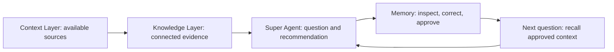

# Super Agent Insights: product story and end-to-end demo

Use this guide to pitch the product, run a 10–15 minute walkthrough, and explain how the local application works. The story follows the same customer intelligence problem through Context Layer, Knowledge Layer, Super Agent, and Memory.

**All customer figures, source descriptions, evaluation scores, and business outcomes below are synthetic demo data.** The AT&T branding is a visual theme; these are not reported AT&T results. The working prototype combines a React UI, a FastAPI API, deterministic responses, and persistent SQLite storage. Live enterprise integrations are a future implementation step.

## The product pitch

> A customer experience team sees churn rising, but the explanation is scattered across customer records, network incidents, billing data, and retention playbooks. Super Agent Insights brings that investigation into one workspace: establish the available context, explore its relationships, ask a business question, inspect the answer's evidence, and decide what the system should remember.
>
> The next conversation can draw on knowledge a person has reviewed and approved. Teams can correct an interpretation, preserve an operating decision, and keep that context available for later questions. This demo shows the complete loop, from a Northeast churn signal to a service recovery priority and a reusable memory.

The product proposition is continuity between investigations: an answer can become inspectable, editable knowledge with an explicit review decision. The prototype demonstrates that workflow; it does not measure model improvement or realized revenue savings.

## The narrative: Jordan's Monday morning investigation

Jordan Davis, the demo workspace administrator, is preparing a customer retention review. Leadership wants to understand why Northeast customers are leaving, where service recovery should start, and how to protect revenue before proposing new offers.

Jordan has three connected questions:

| Business question | Evidence in the mock response | Decision to discuss |
| --- | --- | --- |
| What is driving Northeast churn? | Churn is **4.8%**, compared with **3.1% nationally**. Customers with two or more network incidents are **2.3× more likely to leave**. | Prioritize service recovery for customers with repeated incidents. |
| Where should the team intervene? | Boston and New York account for **58% of repeat service incidents**. Repeated incidents are associated with a **21-point lower satisfaction score**. | Focus the recovery pilot on those incident clusters and communicate proactively. |
| What is the commercial opportunity? | **1,240 priority accounts** represent **$1.8M in annual revenue at risk**. **24%** of eligible households still use legacy broadband plans; bundled accounts have **32% lower churn**. | Protect the service relationship first, then discuss fiber and wireless bundles with eligible customers. |

These are fixture values that make the story coherent. The prototype does not calculate them from live account records, establish causation, or execute the proposed campaign.



## Prepare the demo

Follow [Run locally in the README](../README.md#run-locally) to install dependencies and start both services. Open the [studio](http://127.0.0.1:5173/); [FastAPI documentation](http://127.0.0.1:8000/docs) is available for technical audiences.

Use the left navigation to move between the four stages. At narrow browser widths, use **Switch page** in the top bar. In **Memory**, **More controls** opens the additional memory tools.

For a repeatable rehearsal, start the backend with a separate database instead of clearing an existing workspace. Run this from the repository root, in the backend terminal:

```powershell
$env:STUDIO_DB = 'backend/.data/pitch-demo.sqlite3'
.\.venv\Scripts\python.exe -m uvicorn app.main:app --app-dir backend --host 127.0.0.1 --port 8000
```

Run `npm --prefix frontend run dev` in the other terminal. Use an existing backend or stop it before starting another on port 8000. The dedicated database also persists between rehearsals. In that disposable demo workspace, **Reset workspace** restores the fixtures and clears its saved edits, connector changes, and runs. Export anything you want to keep before resetting. To return to the default database later, remove the `STUDIO_DB` override and restart the backend.

A fresh workspace starts with four selected sources and 108 approved memory records: 90 facts and 18 patterns. Previous questions, approvals, corrections, and consolidation change the memory counts. The existing local workspace may already contain rehearsal records.

## Scene 1 — Establish the context and the business question

**Open:** Context Layer. Allow about two minutes.

**Say:**

> “Jordan starts by checking which information the investigation can use. Customer and incident data sit alongside billing information and the team's operating playbooks.”

**Do:**

1. Point out the four initially selected sources: **Local files**, **Databricks**, **Snowflake**, and **SharePoint**.
2. Open **Add source** to show the catalog and its source filters, then close the dialog. You can inspect a source without changing the workspace.
3. Point to **MCP connectors** and **Add MCP server** as the place to configure additional tool endpoints.
4. Under **Try a question**, keep **How many customers are at risk of churn?** and select **Ask your data**.
5. Show the answer: **1,240 Northeast customers show elevated churn risk**, based on service incidents and recent support interactions.
6. Select **Evals**, then **Run evaluations**, and open **View report**.

**Show:** The fixture report has 24 of 25 cases passing, with groundedness at 96%, answer relevance at 98%, and retrieval precision at 94%. Its review case asks about Southwest churn in 2021, outside the dataset's stated coverage.

**Say:**

> “We have a concrete population to investigate, and we can discuss the limits of the available evidence before relying on a recommendation.”

**How it works today:** The source selections and custom MCP endpoint metadata are saved through FastAPI. **Ask your data** and **Run evaluations** return fixture responses. The 94% readiness indicator and catalog sizes are also fixture metadata. No live evaluation or indexing job runs here. The report's coverage warning is a prepared example; it does not mean arbitrary unsupported agent questions are detected automatically.

Optional: show the upload control, explaining that it registers file names only. It does not send file contents for parsing or retrieval. Similarly, adding an MCP endpoint does not discover or execute its tools.

## Scene 2 — Connect the evidence across systems

**Open:** Knowledge Layer. Allow about one minute.

**Say:**

> “A churn percentage tells us what happened. To choose an intervention, Jordan needs to connect the customer, the service history, the support experience, and the response playbook.”

**Do:**

1. Point to the graph's 108 seeded records and the summary of six source collections and 1,842 vector embeddings.
2. Pan the canvas, zoom, and search for **Boston**. Select a record to inspect it.
3. Use **Explore a source** to open **customer_360**, **network_events**, or **support_tickets**.
4. Show the schema fields and source description. Close the dialog, or use **Ask about this source** to prefill a question in Super Agent.

The mock source descriptions give the business story scale:

| Source | Displayed size | Role in the story |
| --- | --- | --- |
| `customer_360` | 12,480 customer records | Region, plan, and churn-risk context. |
| `billing_summary` | 36,240 billing records | Customer revenue and commercial exposure. |
| `network_events` | 8,642 service events | Repeated incidents and service recovery. |
| `support_tickets` | 2,806 support cases | Contact reasons and satisfaction. |
| Retention playbooks | 148 indexed documents | Service recovery and retention guidance. |
| `enterprise-knowledge` | Azure AI Search index description | Illustrates the intended hybrid retrieval layer. |

**How it works today:** These sizes describe fictional sources; the repository does not contain those underlying tables or documents. The visible graph is generated from the seeded records using source, time, entity, and evidence-link rules. Its **causal** label represents an explicit supporting-record link, not a statistical proof of causation. Azure AI Search and embedding settings are display metadata, with no live index query. The Knowledge Layer uses the fixed seed corpus; newly retained records appear in the **Memory graph**.

## Scene 3 — Turn the churn signal into a recommendation

**Open:** Super Agent. Allow about two minutes.

**Ask the suggested question:**

> What’s driving customer churn in the Northeast?

**Do:**

1. Expand **Agent activity & memory** while the run progresses.
2. Follow the planning, table-query, knowledge-retrieval, evidence-checking, and memory stages.
3. Wait roughly 10–11 seconds for completion.
4. Read the headline: **A service experience gap is driving Northeast churn.**
5. Point out **4.8% Northeast churn**, **1.7 percentage points above the national rate**, and **62% had a service incident**.
6. Open a numbered citation or a source chip such as **network_events**.
7. Point to the recommended action: prioritize proactive service recovery in Boston and New York, then pair it with a targeted loyalty offer.

**Say:**

> “Jordan can now explain the business priority: investigate customers experiencing repeated disruption, focus recovery where those incidents concentrate, and use the retention playbook to shape the response. The answer keeps its source references visible for review.”

The mock findings also show an 18% increase in billing-related support contacts and a potential $1.8M annual revenue exposure across 1,240 at-risk accounts. Treat that as an opportunity described by the scenario, not a forecast of achieved savings.

**How it works today:** FastAPI creates a run, selects one of three prepared answer topics, and recalls up to two relevant approved memories using keyword overlap. The browser polls every 500 milliseconds. Elapsed time advances the displayed agent stages; LangChain, LangSmith, SQL queries, and search agents are not actually invoked. Citations show the response's prepared findings and source labels rather than opening original documents.

At completion, FastAPI saves three draft memory records once per run. They appear after the completion poll, rather than being silently approved for reuse.

## Scene 4 — Review what the system wants to remember

**Open:** **Review memory** under the answer. Allow about two minutes.

**Say:**

> “An answer is useful now. A reviewed memory can be useful next week. Jordan decides which interpretation should carry forward and records the operating decision the team has made.”

**Do:**

1. In the Memory overview, show **Ready to reuse**, **Needs your review**, **Reusable patterns**, and **Knowledge sources**.
2. Open the recent **Northeast churn baseline** fact through **Review memory** or **Saved knowledge**. If several rehearsal runs exist, choose the fact belonging to the question just asked.
3. Inspect its source, question, and **Raw JSON**. Return to **Details**.
4. Select **Edit fact**. For this fictional rehearsal, use:

   > Northeast churn is 4.8% in the mock dataset. Prioritize service recovery for Fiber customers with repeat incidents in Boston and New York. The Northeast retention desk owns the recovery pilot.

5. Enter **Demo planning decision: record the recovery pilot owner** as the correction reason and select **Save correction**.
6. Show that the record still needs review. Select **Confirm memory** and wait until **All changes saved** appears.

The pilot owner is an illustrative decision added by the presenter. It is not an inference from the seeded source data.

Each completed run contributes:

| UI label | What is retained |
| --- | --- |
| Fact | The topic summary, such as **Northeast churn baseline**. |
| Pattern | A prepared finding, such as **Service incidents predict churn**. |
| Conversation note | The question and recommended next step. |

In a fresh workspace, the first completed run takes the total from 108 to 111 records. The three new records begin unapproved. Confirming the edited fact makes that fact eligible for reuse; the other two remain in review.

**How it works today:** A correction requires a reason and clears the record's approval. Recall checks approval, validity, and any supporting memory IDs. For records with explicit evidence dependencies, correcting or invalidating a source also revokes dependent approvals. Seeded patterns and consolidation outputs include these links; the three records generated by an agent run currently have source labels but no `sourceFactIds` dependency links. A pattern label alone does not establish an evidence chain.

To retire a fact, enter a reason and choose **Invalidate fact**. It remains inspectable and is excluded from recall. **Restore fact** makes it valid again, after which it needs approval. Derived patterns are corrected through their supporting facts rather than edited directly.

## Scene 5 — Demonstrate continuity in the next question

**Open:** Memory → **Try memory**, then Super Agent. Allow about two minutes.

**Do:**

1. In **Try memory**, choose **Recall** and enter **Who owns the Northeast recovery pilot?** Select **Run recall**.
2. Find the corrected **Northeast churn baseline** in the results and show the added owner sentence.
3. Optionally choose **Reflect**, run the same question, and inspect the cited retained text.
4. Return to **Super Agent**, select **New conversation**, and ask **Who owns the Northeast recovery pilot?**
5. After completion, show **Context recalled from your memory bank** containing the approved correction.

**Say:**

> “The second conversation carries forward a decision Jordan explicitly approved. The team can inspect that context, change it, or retire it as the operating situation changes.”

**How it works today:** The local recall implementation ranks approved text by matching words. **Reflect** assembles retained excerpts, or uses a current mental model when its source question matches exactly. It does not call an LLM. The agent's main answer remains a fixed topic response; the approved owner sentence appears in the recalled-context panel. Do not present a changed canned answer or improved accuracy as the result of approval.

Refresh the page to demonstrate persistence. The app returns to Context Layer; navigate back to Memory → Saved knowledge to inspect the approved record. The conversation display is temporary and is not rebuilt from stored backend run history after reload. Memories, source selections, and bank settings remain saved.

## Scene 6 — Connect service recovery to the commercial story

**Open:** Super Agent. Allow about two minutes, or use one question for a shorter pitch.

Ask **How is network performance affecting customer experience?** to deepen the operational explanation. Show the 58% incident concentration in Boston and New York, the 21-point satisfaction gap, and the association between proactive notifications and 14% fewer follow-up contacts.

Then ask **Where are our biggest revenue opportunities?** Show:

- **$1.8M** in annual revenue at risk across **1,240** priority accounts.
- **24%** fiber upgrade potential among eligible households in the scenario.
- **32% lower churn** for bundled fiber and wireless accounts in the prepared finding.
- The recommendation to start with service-led retention, then target eligible customers with a bundle.

**Close with:**

> “We started with a churn signal, connected it to service experience, identified a recovery priority, and recorded a reviewed decision for the next investigation. The same workspace connects that operational story to retention and expansion. Super Agent Insights demonstrates how enterprise context, explainable answers, and human-controlled memory can work together.”

Each additional question creates another three draft records. The demo does not send outreach, create CRM tasks, or execute offers.

## Additional user flows

Use these after the core story when an audience wants to explore the memory workspace in more depth. Open the named tool through **More controls**, unless it is a primary Memory tab.

| Tool | What the user does | Current behavior and useful pitch point |
| --- | --- | --- |
| Memory graph | Search a city or topic, pan, zoom, select a record, and open its details. | Shows the current active memories and inferred relationships. Viewport and dragged node positions are temporary. |
| Retain | Enter a document ID, context, and one fact per line; choose **Retain facts**. | Creates reviewable records from the pasted lines and persists them through the API. Extraction is a local line split, not document understanding. |
| Saved knowledge → Consolidate | Consolidate approved facts, then review the resulting patterns. | Groups approved facts by source and creates or updates patterns with supporting IDs. New or changed patterns require review. Needs observations enabled in Configuration. |
| Mental models | Inspect the seeded **Retention priorities** model, refresh it, or create a model for a recurring question. | Saves an editable summary with source IDs. Refresh uses matching approved excerpts. Models with **Refresh after consolidation** enabled refresh when the user runs consolidation. |
| Knowledge pages | Open **Service and retention intelligence**, inspect its evidence, edit it, or create a page. | Builds content from approved patterns and keeps source IDs. User-triggered refresh or consolidation updates generated content; there is no background publishing job. |
| Documents | Select a source reference. | Filters its retained memories; it is not a repository of uploaded document bytes. |
| Entities | Select Boston, Fiber, Network, or another displayed entity. | Filters memories using the prototype's fixed list of recognized entity names. |
| Operations | Inspect retain, curation, and tool activity. | Displays saved operation entries and memory lifecycle timestamps; it is not a comprehensive security audit trail. |
| Bank templates | Load Customer intelligence, Network operations, or Revenue growth; use **Validate only** before applying. | Validates a JSON manifest and saves supported settings, model definitions, and directives. Exporting a bank manifest is separate from exporting memory records. |
| Configuration | Change missions, extraction settings, dispositions, or directives and select **Save configuration**. | Persists the configuration. Most settings illustrate the intended policy surface and do not alter the fixed backend answers; the observations toggle controls local consolidation. |
| Webhooks | Save an HTTPS subscription and use **Preview event** or **Generate payload**. | Saves definitions and previews payloads. Signing, retries, delivery guarantees, and sensitive-data detection shown in the panel describe an intended contract, not implemented services. No HTTP delivery occurs. |
| Export memory | Download the memory JSON. | Exports records and review state for inspection. It does not replace a complete database backup or include the whole bank configuration. |

For a dependency-review demonstration, inspect the seeded **Boston · Bundle adoption · Q1** pattern and its supporting facts. Correcting **Boston · Fiber churn · Q1** returns linked knowledge to review. Approve the corrected source first; then review the affected patterns and refresh dependent summaries. Use a disposable rehearsal workspace for this exercise.

## How the local application works

The browser loads view models and saved state from FastAPI before rendering the main app. The `StudioApi` interface separates screen actions from the HTTP implementation. Vite proxies `/api` requests from port 5173 to FastAPI on port 8000 by default.

| User action | Current implementation |
| --- | --- |
| Open the app | `GET /api/bootstrap` returns fixture metadata, the fixed knowledge corpus, and persisted workspace state. Startup errors show a retry screen. |
| Connect a source, configure MCP, or register file names | `PUT /api/context` validates and saves the context snapshot. Writes are serialized by the frontend adapter. At least one selected source is required to query, evaluate, or start an agent run. |
| Ask a quick question | `POST /api/query` returns a deterministic answer. It does not create an agent run or save three memories. |
| Run evaluations | `POST /api/evaluations` returns the prepared report. |
| Ask Super Agent | `POST /api/runs` records the question, topic, start time, and recalled approved context. Revenue/sales/growth/opportunity words select the revenue topic first; network/latency/outage/performance words select network; other questions use churn. |
| Follow progress | `GET /api/runs/{id}` advances a time-based 0–12 progress scale. The completion poll saves the three draft memories once and returns the updated memory list. |
| Correct, approve, or invalidate memories in the UI | The browser applies review rules and sends a full snapshot to `PUT /api/memories`; FastAPI validates records and approved evidence dependencies. A separate `PATCH /api/memories/{id}` correction endpoint also exists. |
| Save memory tools and configuration | Local tool handlers prepare results; `PUT /api/bank` saves configuration, models, directives, pages, webhook definitions, and operation entries. |
| Reset the workspace | `POST /api/reset` restores fixture state in the active database. Use it only when its saved changes are disposable. |

The default SQLite database is `backend/.data/studio.sqlite3`, created on startup. `STUDIO_DB` selects another path. Source selections, MCP configuration, file names, memories, approvals, and bank state survive restarts. Backend run records are stored too, but the UI does not restore its conversation list from them. Quick-query results, selected screens, graph positions, and unsent text are temporary UI state.

Source selection is a configuration demonstration: keeping at least one source selected enables the mock workflows. It does not permission-filter the fixed answers, seed graph, or memory corpus. A real implementation must apply source authorization and tenant boundaries to retrieval and recall.

## Questions to expect during a pitch

| Question | Accurate answer for this prototype |
| --- | --- |
| Is it connected to our Databricks, Snowflake, or SharePoint account? | No. The catalog and source schemas are prepared examples. The selections and endpoint metadata are saved, but no external account is queried. |
| Does memory train the model? | No. Approval makes retained context eligible for recall. This prototype has no model training or live LLM call. |
| Why do different questions sometimes produce the same answer? | The backend selects among three fixed topics. Recalled memory can change the context panel while the prepared answer remains the same. |
| Are the scores and business outcomes measured? | No. Readiness, evaluation scores, source sizes, answer metrics, and revenue exposure are fixture values. Memory overview counts are computed from the current records. |
| Is this production authentication or a shared enterprise workspace? | No. The backend is a single-user local prototype without production authentication or tenant isolation. The profile and private-workspace labels are illustrative. |
| What would a live implementation replace? | Source ingestion and authorization, search, agent orchestration, memory generation/consolidation, and webhook delivery. Keep the screen contracts and map real provider results through the adapter. |

## Rehearsal checks and recovery

- Confirm both terminals remain running and open the [health endpoint](http://127.0.0.1:8000/api/health). It should return `{"status":"ok"}`.
- If the UI says the workspace is unavailable, start FastAPI and use **Retry connection**. When using another API location, check `VITE_API_BASE_URL` and restart Vite after changing it.
- If the server reports a port is already in use, reuse the existing service or stop it before starting another; the standard UI expects port 5173 and the proxy expects backend port 8000.
- Keep at least one source selected. New memories need approval before recall; linked patterns also need approved, valid supporting facts.
- Wait for an agent run to finish before refreshing or starting a new conversation. Completion polling is what persists its new memories.
- In Memory, wait for **All changes saved**. If saving fails, use **Retry saving** and inspect the API error before claiming the change persisted.
- Expect counts to grow during rehearsals. Use the dedicated demo database or reset only a disposable workspace to return to the baseline.

The local smoke check covered quick questions, fixture evaluations, graph/source inspection, agent completion, memory approval, configuration saving, and persistence after reload. The backend's 12 tests, five frontend self-checks, and production build passed during that check. The optional tools above are described from their implementation; this does not establish live enterprise integration coverage.

## Where the story and behavior come from

| Repository reference | What to inspect |
| --- | --- |
| [Mock fixtures](../backend/data/fixtures.json) | Exact prompts, metrics, sources, evaluation report, 108-record corpus, templates, and seeded bank content. |
| [API endpoints](../backend/app/main.py) | Bootstrap, validation, queries, run timing, completion persistence, and reset. |
| [Backend services](../backend/app/service.py) | Topic routing, approved-memory recall, and the three draft records per run. |
| [Memory rules](../frontend/src/lib/memory.ts) | Review counts, evidence eligibility, correction, invalidation, and entity labels. |
| [Memory tool helpers](../frontend/src/lib/compounding.ts) | Local recall, synthesis, consolidation, templates, and webhook previews. |
| [Backend integration guide](BACKEND_INTEGRATION.md) | The technical work needed to connect real services while retaining the UI. |
